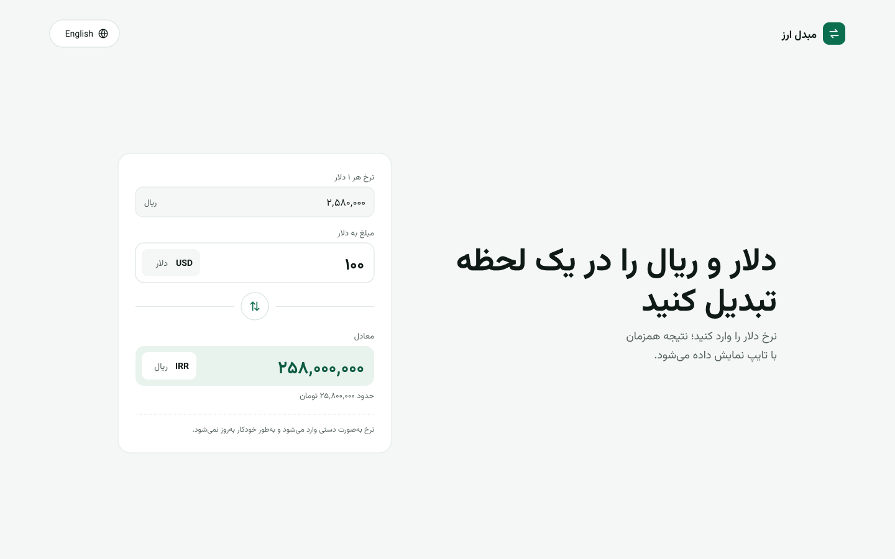
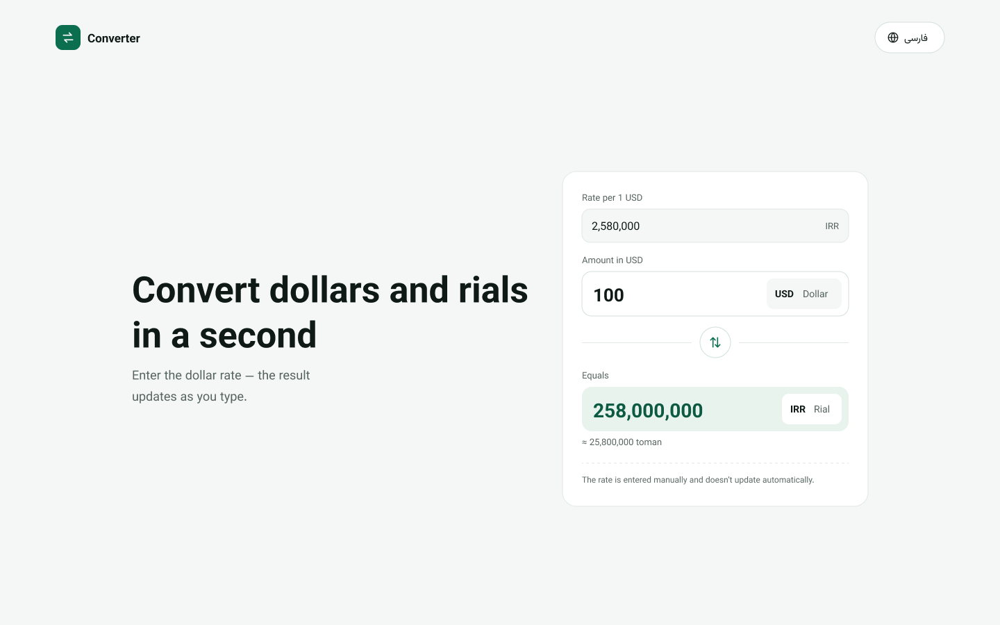
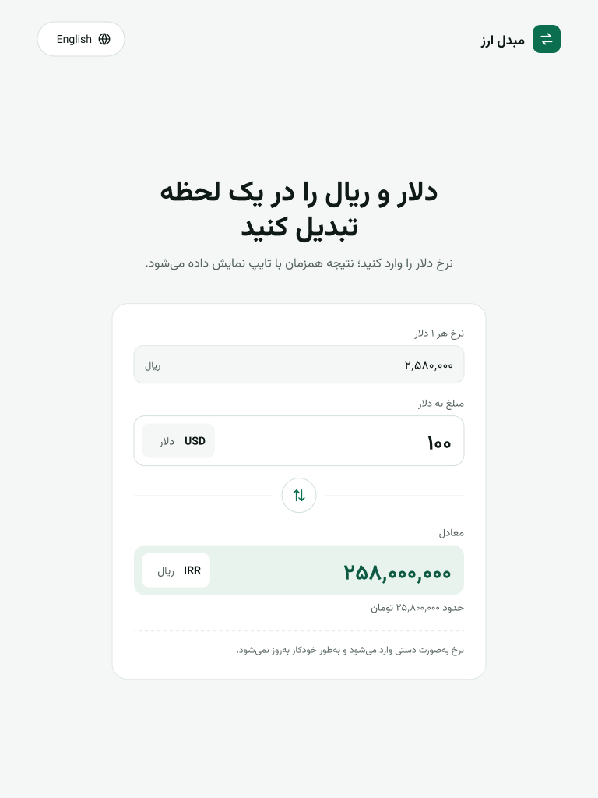
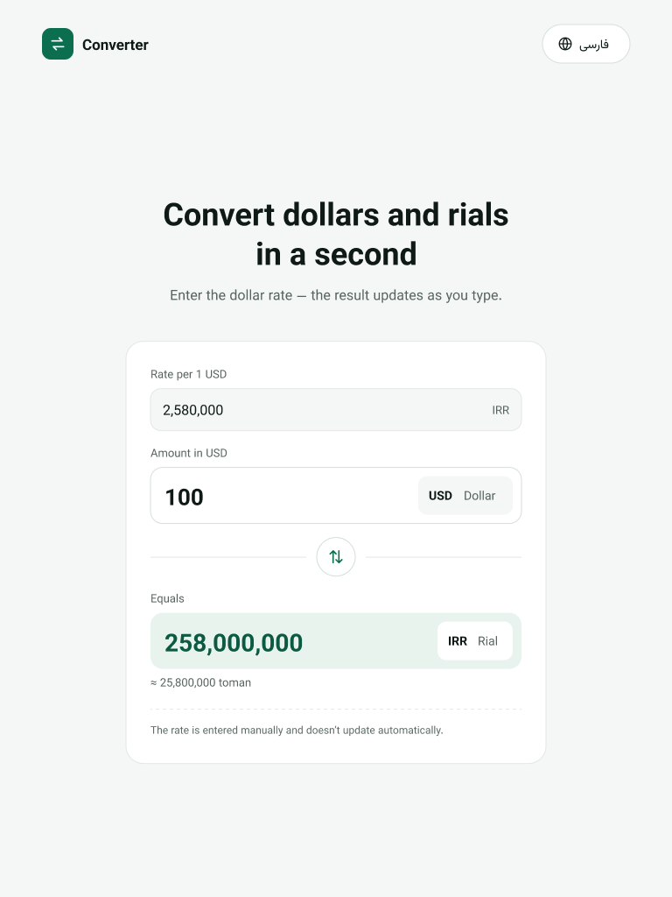
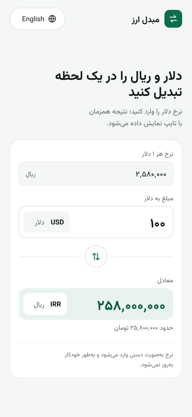
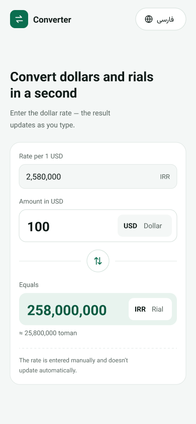

# Currency Converter

A Persian-language USD/IRR currency converter built with React, TypeScript, and Vite.

## Current Status

The Persian version is implemented. The English version is currently available only as a Figma design.

## Features

- Convert USD to IRR and IRR to USD
- Enter the exchange rate manually
- See the result while typing
- Enter numbers using Persian, Arabic, or English digits
- See the approximate Toman equivalent of the IRR result
- Use the app on mobile, tablet, and desktop

The exchange rate is entered in IRR per USD and is not updated automatically.

## Design

The interface and icons were designed in Figma before implementation.

[View the Figma design](https://www.figma.com/design/2Zvzg4WlxPNQD21CyuOgcn/Currency-Converter?node-id=0-1)

### Desktop





### Tablet





### Mobile





### Design Inspiration

The following designs were used as visual references for inspiration:

- [Currency Converter Mobile App](https://dribbble.com/shots/27059919-Currency-Converter-Mobile-App-UI-Design)
- [Currency Converter Widget for iOS](https://dribbble.com/shots/25491765--Currency-Converter-Widget-for-iOS-Daily-Design-Challenge)
- [Daily UI — Currency Converter](https://dribbble.com/shots/6839064-Daily-UI-004-Currency-converter-app)
- [Swiftbank — Currency Converter](https://dribbble.com/shots/25108909-swiftbank-AI-Digital-Banking-App-Currency-Converter-Rate-UI)

### Color Palette

Light backgrounds keep the interface simple. Dark green highlights the conversion result, while a soft green background separates it from the input fields. Muted colors keep secondary text less prominent.

| Color | Hex | Usage |
|---|---|---|
| Light background | `#F4F7F6` | Page background |
| White | `#FFFFFF` | Form background |
| Green | `#0B6E4F` | Primary accent |
| Dark green | `#0B5A41` | Result text |
| Soft green | `#E8F3EE` | Result background |

## Getting Started

Run the following commands from the project folder.

Install dependencies:

```bash
npm install
```

Start the development server:

```bash
npm run dev
```

Create a production build:

```bash
npm run build
```

Preview the production build locally:

```bash
npm run preview
```

## Resources and Tools

- **Vazirmatn:** Downloaded from [Fontfa](https://fontfa.com/font/vazirmatn/).
- **[Figma](https://www.figma.com/design/2Zvzg4WlxPNQD21CyuOgcn/Currency-Converter?node-id=0-1):** Used to design the interface and create the icons.
- **Dribbble:** Used for design inspiration. Reference links are listed above.
- **ChatGPT:** Used as a supporting tool for coding guidance and troubleshooting.

## Future Improvements

- Implement the English version.
- Add Persian digit formatting and thousands separators to input fields.